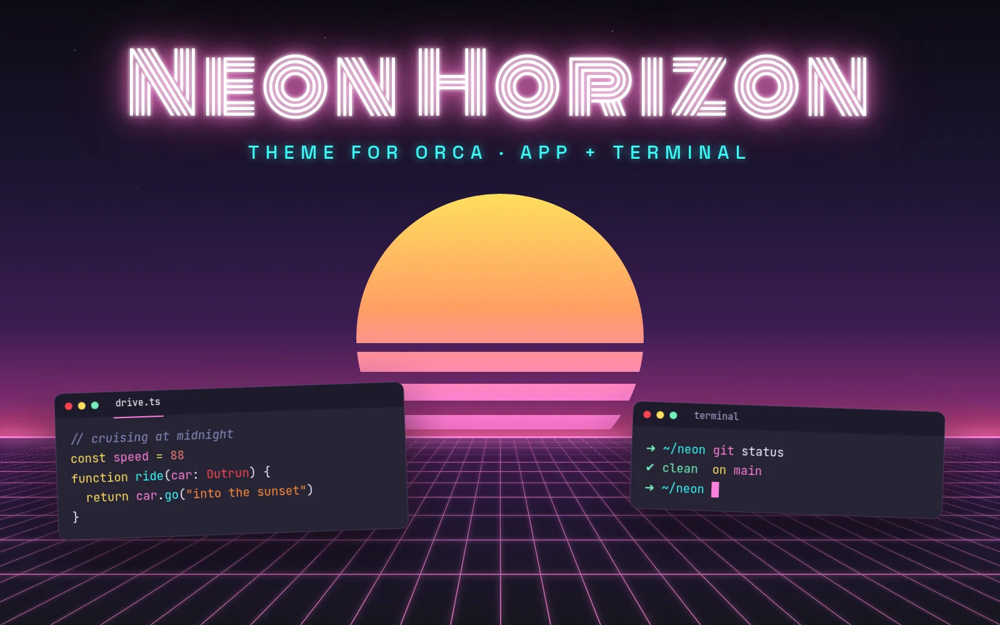

# Neon Horizon



A retro '80s neon dark theme for [Orca](https://github.com/stablyai/orca): an app theme (UI + code colors) and a matching terminal palette.

## Install

```sh
orca plugin install yuribodo/neon-horizon
```

Then in Settings → Appearance pick **Neon Horizon** as the app theme, and under Terminal Themes → Dark Theme.

## Develop

```sh
orca plugin validate .
orca plugin dev watch .   # live-reloads edits to themes/ and terminal/
```

Files: `themes/neon-horizon.json` (app tokens + `tokenColors`), `terminal/neon-horizon.json` (ANSI palette).
